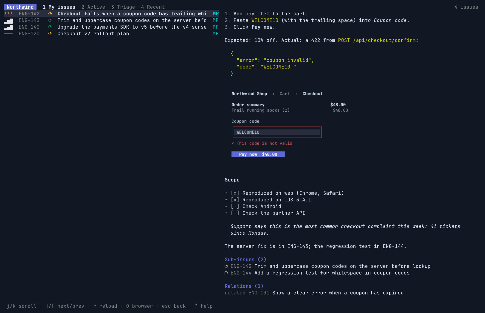
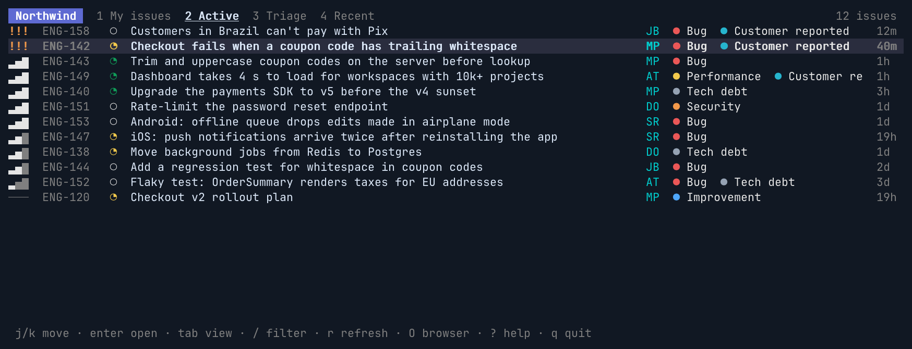
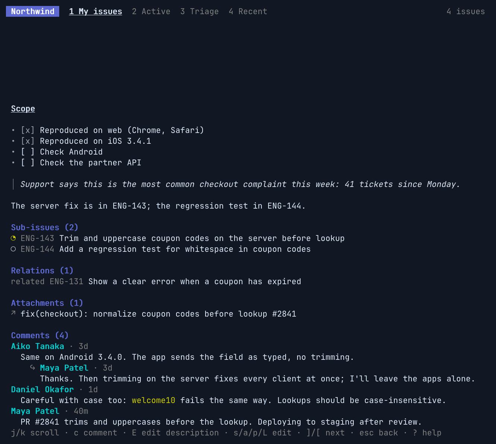
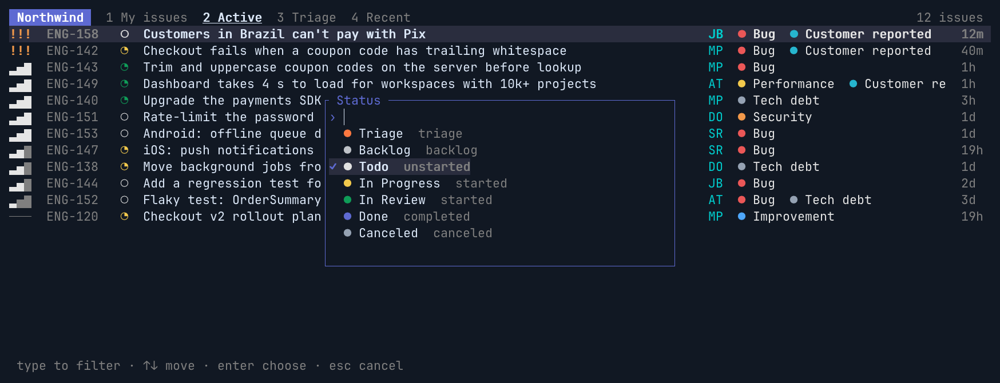
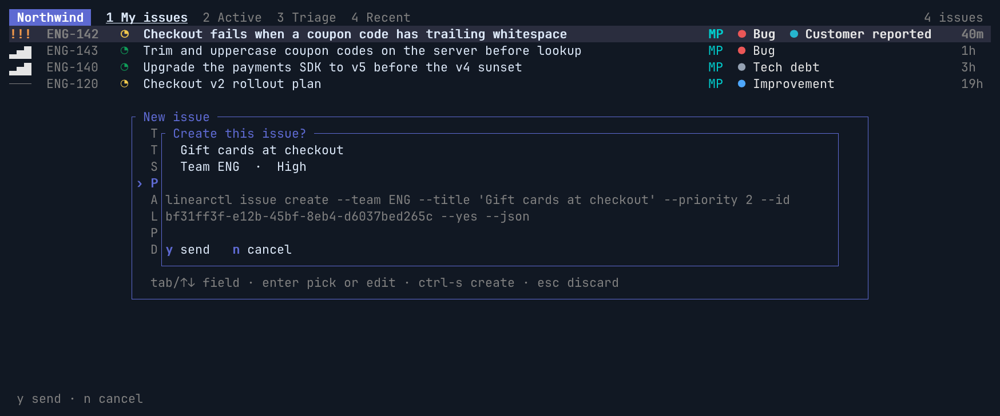
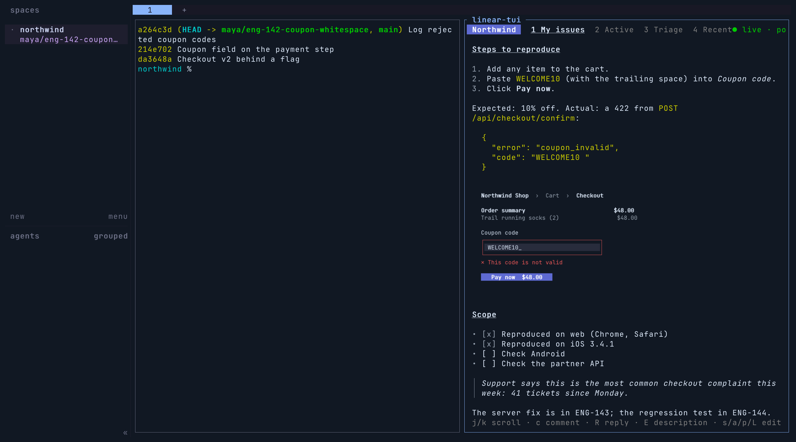
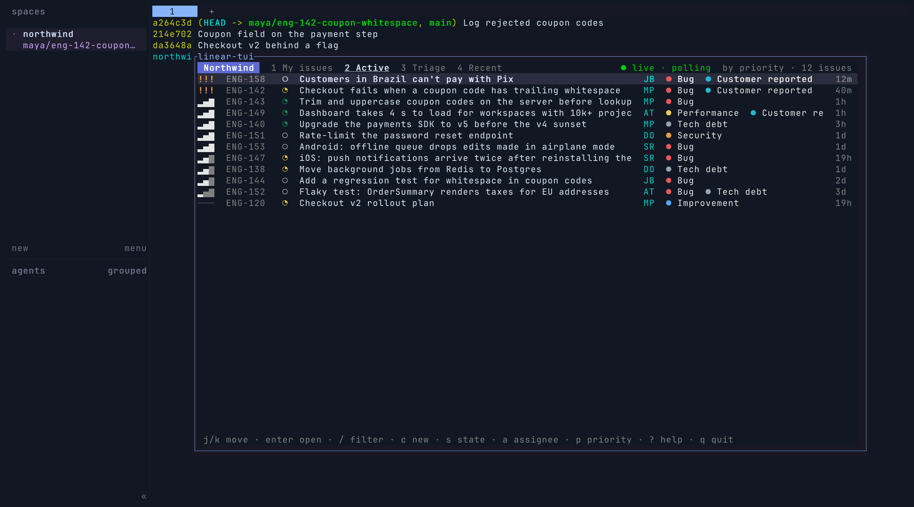

# linear-tui

[](https://github.com/solcreek/linear-tui/actions/workflows/ci.yml)
[](https://www.npmjs.com/package/linear-tui)
[](LICENSE)
[](Cargo.toml)
[](https://ratatui.rs)
[](https://github.com/solcreek/linear-cli)

A terminal UI for [Linear](https://linear.app), in Rust and Ratatui. It holds no
API key and never calls api.linear.app: every read and write is a
[`linearctl`](https://github.com/solcreek/linear-cli) `--json` call, so anything
a person does here an agent can do with the CLI.



<sub>The demo workspace (`--demo`): Northwind, its people and its issues are fictional.
Rendered with [termshot](https://github.com/momiji-rs/termshot) by
`scripts/screenshots.sh`.</sub>

## Status

Early, before the first release: the issue list with views, paging, a filter
and full-text search; the issue detail with Markdown, inline images (kitty,
Sixel, iTerm2 or half blocks), sub-issues, relations, attachments and threaded
comments; and writes: state, priority, assignee, labels and project through
pickers, comments and descriptions in `$EDITOR`, archiving, and a form for new
issues. Every write is a linearctl dry run first, and the confirm dialog shows
the exact command. With linearctl 0.2.0 or later the list updates live
(`linearctl watch`) and calls share a few long-lived linearctl processes
(`serve --stdio`); see
[docs/design.md](docs/design.md) for the whole plan. The npm package
`linear-tui` is a name placeholder until the first release.

| | |
|---|---|
|  |  |
|  |  |

## Try it

Needs Rust 1.90 or newer. The demo needs no Linear account:

```sh
git clone https://github.com/solcreek/linear-tui.git
cd linear-tui
cargo build
target/debug/linear-tui --demo
```

For your workspace, install linearctl and log in (the key stays with linearctl):

```sh
go install github.com/solcreek/linear-cli/cmd/linearctl@latest   # or: npm i -g @solcreek/linear-cli
pbpaste | linearctl auth login --yes
target/debug/linear-tui
```

Keys follow Linear's own wherever a terminal allows: `j`/`k` move, `enter`
opens, `esc` goes back, `J`/`K` step through issues, `g m` `g a` `g t` jump to My
issues, Active and Triage, `/` filters (`enter` searches every issue), `c`
creates, `e` edits, `r` renames, `s` `p` `a` `L` `P` `C` `E` set status,
priority, assignee, labels, project, cycle, estimate, `i` assigns to you, `m`
comments, `ctrl-e` edits the description in `$EDITOR`, `y` `Y` `b` copy the ID,
URL and branch name, `ctrl-z` undoes, and `ctrl-k` finds any command by name. The demo takes no writes, but shows every dry run and confirm dialog.

`linear-tui ENG-142` (or the issue's linear.app URL) opens that issue first.

## herdr

In [herdr](https://herdr.dev), the plugin in `herdr-plugin/` opens linear-tui
over the focused pane, beside it, or in a popup, and Ctrl+click on a Linear
issue link opens the issue there instead of in the browser.





```sh
herdr plugin install solcreek/linear-tui/herdr-plugin
herdr plugin action invoke solcreek.linear-tui.demo   # the demo workspace, no account
```

It needs `linear-tui` and `linearctl` on `PATH` or in `~/.cargo/bin`, `~/go/bin`
or Homebrew's bin; or set `LINEAR_TUI_BIN` and `LINEARCTL` in herdr's environment.
When one is missing, the pane says which and how to get it.

The actions are `solcreek.linear-tui.open` (over the focused pane),
`.open-split`, `.popup`, `.demo` and `.open-link` (the link handler's). Bind
one in `~/.config/herdr/config.toml`:

```toml
[[keys.command]]
key = "prefix+alt+l"
type = "plugin_action"
command = "solcreek.linear-tui.open"
description = "Linear"
```

Images show over the pane and in a split; a popup passes no terminal graphics,
so there they are half blocks. `LINEAR_TUI_ARGS` in herdr's environment adds
arguments to every linear-tui the plugin starts (e.g. `--images off`).

## Tests

All tests are Rust.

    cargo test                              # everything; docs/design.md vs linearctl 0.1.0
    LINEARCTL_LIVE=linearctl cargo test     # the design vs the installed linearctl
    cargo llvm-cov --summary-only           # coverage

With Homebrew's Rust (no rustup `llvm-tools`), point cargo-llvm-cov at the
matching LLVM: `LLVM_COV=$(brew --prefix llvm@22)/bin/llvm-cov`
`LLVM_PROFDATA=$(brew --prefix llvm@22)/bin/llvm-profdata`.

Screenshots: `scripts/screenshots.sh` drives `--demo` in tmux, records what it
writes (kitty graphics included) and renders that with termshot (`TERMSHOT=/path/to/termshot` if it is not on `PATH`).
`scripts/herdr-screenshots.sh` does the same for the herdr plugin, in a herdr
of its own that shares nothing with yours; it needs termshot 0.4.0 or later
(`--cell`).
